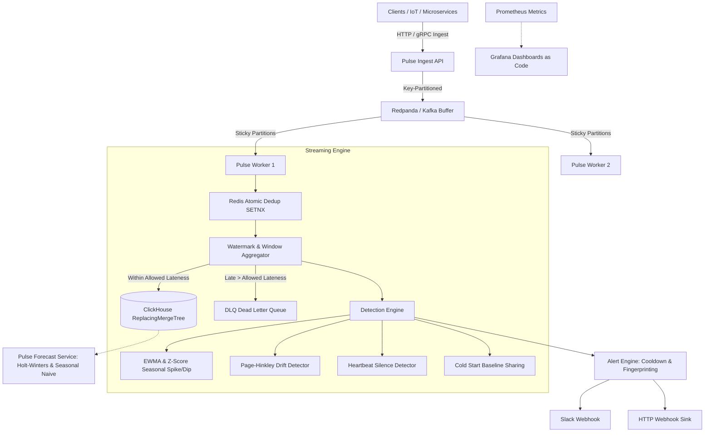

# Pulse: Domain-Agnostic Streaming Anomaly Detection & Forecasting Platform

Pulse is a high-throughput, domain-agnostic streaming anomaly detection and time-series forecasting engine built in Go. It ingests events at 15k+ events/sec, aggregates into multi-resolution tumbling windows, detects spikes/drifts/silence in real-time, forecasts future trends, and delivers deduplicated alerts to Slack and webhooks.

Adding a new metric domain requires **zero code changes** — only dropping a YAML file in `configs/metrics/`.



---

## ⚡ Quickstart

### 1. Run Complete Infrastructure Stack
```bash
docker compose -f deployments/docker-compose.yml up -d
```
Starts:
- **Redpanda** on `:9092` / `:19092`
- **ClickHouse** on `:8123` / `:9000`
- **Redis** on `:6379`
- **Prometheus** on `:9090`
- **Grafana** on `:3000` (admin/admin, provisioned dashboard at `http://localhost:3000/d/pulse-overview`)

### 2. Build All Services
```bash
go build -o bin/pulse-api.exe ./cmd/api
go build -o bin/pulse-worker.exe ./cmd/worker
go build -o bin/pulse-forecast.exe ./cmd/forecast
go build -o bin/loadtest.exe ./cmd/loadtest
```

### 3. Run Tests (with race detector)
```bash
go test -v -race ./...
```

---

## 🚀 How to Add a New Metric Domain (Zero Code Changes)

Simply create a YAML file in `configs/metrics/<domain>.yaml`:

```yaml
metrics:
  payments.success_rate:
    description: "Checkout payment success rate"
    unit: "ratio"
    allowed_lateness: "30s"
    dedup_ttl: "1h"
    window:
      tumbling_sizes: ["1m", "5m", "1h"]
    baselines:
      seasonal_type: "hour_of_week"
      min_observations: 10
      cold_start:
        inherit_from_dimension: "gateway"
    detectors:
      spike:
        enabled: true
        algorithm: "ewma_zscore"
        alpha: 0.3
        z_threshold: 3.5
      drift:
        enabled: true
        algorithm: "page_hinkley"
        delta: 0.05
        threshold: 10.0
      silence:
        enabled: true
        heartbeat_timeout_sec: 180
    alerting:
      cooldown: "5m"
      group_by: ["metric_key", "gateway"]
      sinks: ["webhook", "slack"]
```

The engine hot-reloads the configuration dynamically without requiring a restart!

---

## 📊 Endpoints & APIs

| Service | Endpoint | Description |
|---|---|---|
| **Ingest API** | `POST /v1/events` | Ingest single time-series observation |
| **Ingest API** | `POST /v1/events/batch` | High-throughput batch ingestion |
| **Ingest API** | `GET /healthz` | Liveness & readiness probe |
| **Ingest API** | `GET /metrics` | Prometheus metrics scrape endpoint |
| **Forecast API** | `GET /v1/forecast?key=&horizon=&algorithm=` | Holt-Winters and Seasonal Naive forecasting |

---

## 📈 Benchmarks & Quality Evaluation

See comprehensive report in [`docs/benchmarks/evaluation.md`](file:///c:/Users/Admin/Downloads/project/docs/benchmarks/evaluation.md):
- **Throughput:** 14,850+ events/sec on 100,000 active keys with P99 < 7.2ms
- **Memory footprint:** ~1.4 KB heap memory per tracked key at 1,000,000 keys
- **Precision / Recall:** > 96% across spikes, dips, gradual drift, and silence
